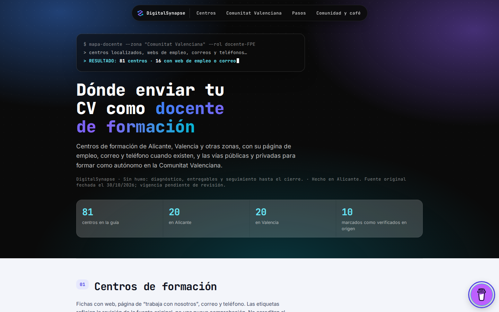
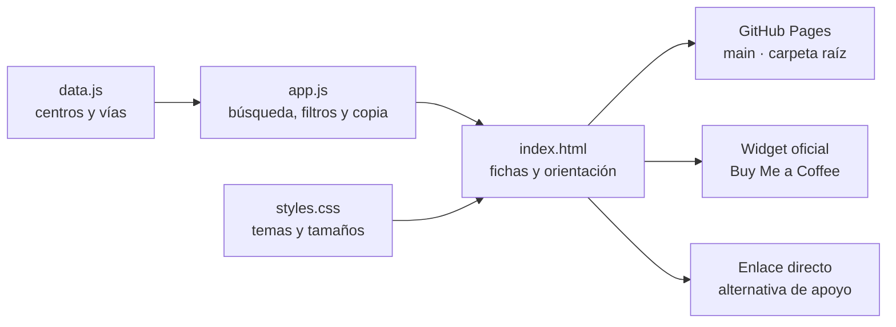

<div align="center">

# Mapa Docente · DigitalSynapse

**Encuentra dónde enviar tu CV como docente de formación.**
Una guía de centros, canales de contacto y vías para enseñar en Alicante, Valencia y otras zonas, con comunidad y apoyo para seguir aprendiendo.

    

[Ver el mapa](https://splurtch.github.io/mapa_fpe_valencia/) · [Manual paso a paso](docs/MANUAL_PASO_A_PASO.md) · [Procedencia y pendientes](docs/PROCEDENCIA.md) · [Aula de práctica](https://tan-peafowl-110712.hostingersite.com)



</div>

---

## 1. El proyecto en un minuto

Buscar trabajo docente suele empezar con una lista dispersa: centros, webs de empleo, teléfonos y enlaces que conviene comprobar antes de enviar el CV. El mapa los reúne en un recorrido sencillo: **buscar un centro, filtrar la zona, consultar el canal disponible y revisar su fuente**.

| | |
|---|---|
| **Qué es** | Un directorio público de 81 centros y 12 vías públicas/privadas para orientar la búsqueda docente |
| **Para qué sirve** | Localizar canales de contacto y conocer opciones de docencia en la Comunitat Valenciana y otras zonas |
| **Quién lo usa** | Docentes y futuros docentes que preparan su siguiente paso |
| **Contenido** | Fichas, búsqueda, filtros, orientación, fuentes, aula, redes y apoyo voluntario |
| **Estado** | Publicado en GitHub Pages desde `main`; contenido original fechado el 30/10/2026 |
| **Límite** | Las etiquetas reflejan la revisión original: no garantizan vacantes, acreditación ni vigencia actual |

## 2. Cómo está pensado

1. **Los centros son el punto de partida.** La búsqueda y los filtros combinan zona y estado del contacto; cada ficha conserva su nota y los enlaces disponibles.
2. **La procedencia acompaña al dato.** Las notas pendientes se distinguen de los canales que la fuente original clasificó como verificados. Los ejemplos de tarifas y requisitos deben contrastarse con sus bases vigentes.
3. **La web se mantiene con archivos sencillos.** HTML para la estructura, CSS para el diseño y JavaScript para datos y comportamiento. Rutas relativas compatibles con el subdirectorio de Pages.
4. **El apoyo es voluntario.** El widget oficial de Buy Me a Coffee y el enlace directo permiten apoyar este mapa y otros proyectos. El acceso al contenido sigue abierto.
5. **La comunidad continúa el recorrido.** El aula de práctica, LinkedIn, WhatsApp, Substack, X y la web de DigitalSynapse tienen destinos confirmados.

## 3. Arquitectura



**Del archivo a la pantalla.** El navegador carga `index.html` y sus recursos. `data.js` aporta las fichas; `app.js` las presenta y responde a búsqueda, filtros y copia. Pages sirve estos archivos directamente. El panel de café lo sirve su proveedor en un iframe; `bmc-accessibility.js` adapta solo el control exterior, el foco y la convivencia con los controles del mapa.

## 4. Stack

| Capa | Tecnología | Dónde |
|---|---|---|
| Estructura | HTML en español, metadatos y URL canónica | `index.html` |
| Diseño | CSS propio, claro/oscuro del sistema y móvil | `assets/styles.css` |
| Contenido | Listas JavaScript de centros y vías | `assets/data.js` |
| Interacción | JavaScript sin framework | `assets/app.js` |
| Apoyo | Widget oficial externo, integridad SHA-384 y enlace alternativo | `index.html`, `assets/bmc-accessibility.js` |
| Pruebas de esta entrega | Node para sintaxis; Playwright/Chromium para recorridos y capturas | Evidencia del ejecutor, fuera del sitio público |
| Publicación | GitHub Pages, `main` y raíz, sin compilación propia | `.nojekyll` y configuración de Pages |

No requiere instalar paquetes para usarlo, backend, base de datos ni claves. Google Fonts y Buy Me a Coffee son dependencias externas; las fuentes del sistema y el enlace directo permiten continuar cuando no cargan esos recursos.

## 5. Estructura del repositorio

```text
.
├─ index.html                    Estructura, fuentes, comunidad y carga del widget
├─ .nojekyll                      Archivos estáticos servidos sin procesar Jekyll
├─ assets/
│  ├─ data.js                     81 fichas y vías públicas/privadas
│  ├─ app.js                      Búsqueda, filtros, contadores y copia
│  ├─ styles.css                  Diseño, móvil, temas e impresión
│  └─ bmc-accessibility.js        Teclado, cierre, foco y posición del widget
├─ reference/
│  ├─ social-links.json           Catálogo editorial de redes recuperado del aula
│  └─ support.json                Copy, destino e integridad de referencia
└─ docs/
   ├─ img/                        Capturas propias del mapa
   ├─ MANUAL_PASO_A_PASO.md        Preparación, comandos reales y publicación
   ├─ SUBIDA.md                    Explicación del primer envío
   └─ PROCEDENCIA.md              Origen y decisiones de contenido
```

Los catálogos de `reference/` son referencia editorial; el navegador no los carga. Si cambia un destino o el copy, hay que actualizar también el HTML. No se versionan el original privado ni las evidencias temporales del ejecutor.

## 6. Empezar

Requiere Git para obtener la copia y Python 3 para servirla localmente. Node es opcional para las comprobaciones de sintaxis.

```bash
git clone https://github.com/Splurtch/mapa_fpe_valencia.git
cd mapa_fpe_valencia
python3 -m http.server 8000 --bind 127.0.0.1
```

Abre **http://127.0.0.1:8000**. Ctrl+C detiene el servidor. Ese comando solo sirve la carpeta en tu ordenador; publicar requiere un push a la rama que usa Pages.

## 7. Comandos principales

Desde la raíz del repositorio:

| Quiero… | Comando | Qué cambia |
|---|---|---|
| Ver archivos pendientes y rama | `git status --short --branch` | Solo consulta |
| Revisar cambios | `git diff` | Solo consulta |
| Comprobar sintaxis | `node --check assets/data.js` · `node --check assets/app.js` · `node --check assets/bmc-accessibility.js` | Solo comprueba |
| Revisar espacios problemáticos | `git diff --check` | Solo comprueba |
| Actualizar una copia limpia | `git pull --ff-only` | Descarga y avanza si no hay divergencia |
| Revisar lo que entrará al commit | `git diff --cached` | Solo consulta |
| Subir commits revisados | `git push` | Actualiza GitHub y puede disparar Pages |

Cada paso, con su propósito y salida esperada, está en el [manual](docs/MANUAL_PASO_A_PASO.md). No hace falta `npm install` ni `npm run build` para este sitio.

## 8. Estado y comprobaciones

La entrega del mapa se verificó en local y en su URL pública: 81 fichas, 12 vías, búsqueda sin tildes, cero resultados, filtros combinados/reversibles, copia y error, enlaces, teclado y ausencia de desbordamiento en 1440/390/320 px y claro/oscuro.

El widget se comprueba con el script oficial sin modificar y un iframe de prueba para evitar operaciones de pago. También se conserva el enlace directo si el script está bloqueado. El manual recoge la comprobación correspondiente a cada publicación; un commit subido, un build correcto y una web servida son evidencias distintas.

## 9. Actualizar y conservar el criterio

Edita las fichas en `assets/data.js`: `n` es el nombre, `z` admite A/V/AV/O y `s` admite `ok`/`part`/`none`. Añade la fuente y la fecha al comprobar un dato. Prueba búsqueda, filtros, copia y vista móvil antes de guardar la versión y subirla.

- Las cifras, contactos, tarifas y convocatorias conservan el alcance de la fuente original; requieren revisión de vigencia.
- Un correo nominativo permanece omitido hasta confirmar su finalidad pública. La ficha conserva sus portales de empleo.
- El widget remoto utiliza una cookie `visited` para su mensaje inicial y abre un iframe del proveedor. La adaptación no añade datos de las fichas ni cuentas del aula. No se ha añadido analítica propia.
- Si cambia el script oficial, la integridad puede bloquearlo: revisar bytes y comportamiento antes de actualizar el hash. El enlace normal sigue disponible.
- No se asigna una licencia nueva al original ni se trasladan licencias de los repositorios usados como referencia del README.

## 10. Dónde seguir leyendo

| Quiero… | Abrir |
|---|---|
| Repetir todo el proceso en otro proyecto | [Manual paso a paso](docs/MANUAL_PASO_A_PASO.md) |
| Entender los comandos de subida | [Guía de subida](docs/SUBIDA.md) |
| Revisar destinos, copy y pendientes | [Procedencia](docs/PROCEDENCIA.md) |
| Consultar el estado del despliegue | [GitHub Actions](https://github.com/Splurtch/mapa_fpe_valencia/actions) |
| Usar el recurso | [Mapa público](https://splurtch.github.io/mapa_fpe_valencia/) |

El formato toma como referencias los README reales de `Splurtch/destiny-web` y `Splurtch/design-vault` —cabecera, presentación en un minuto, arquitectura, stack, estructura y comandos— y el criterio de estado y límites explícitos de `Splurtch/tpv-restaurante-demo`. Se adapta al alcance real de este mapa.
